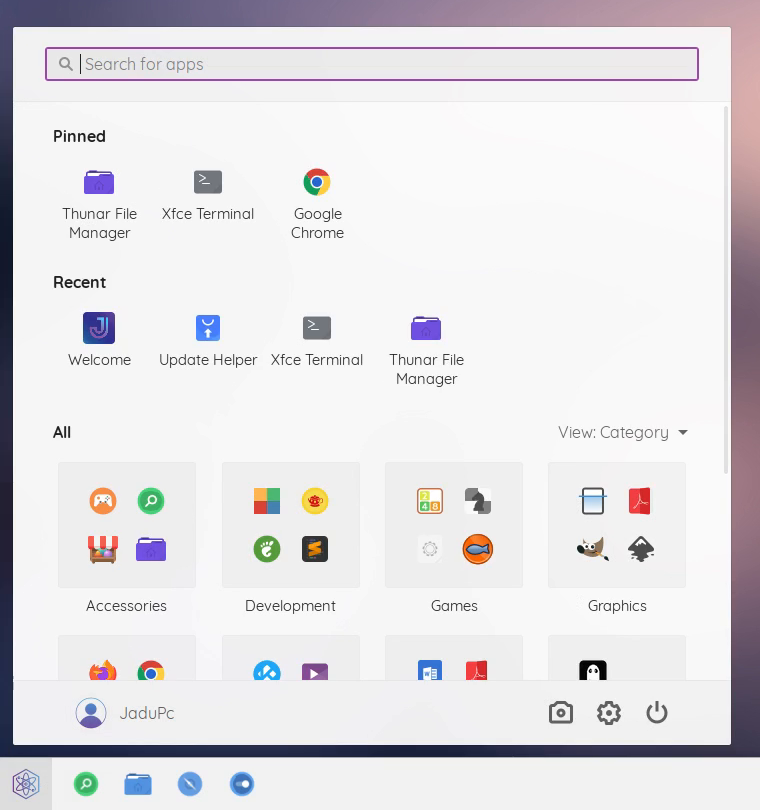
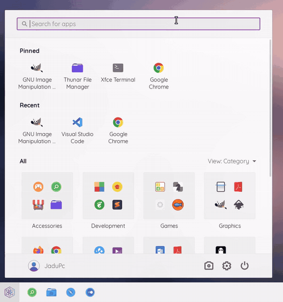
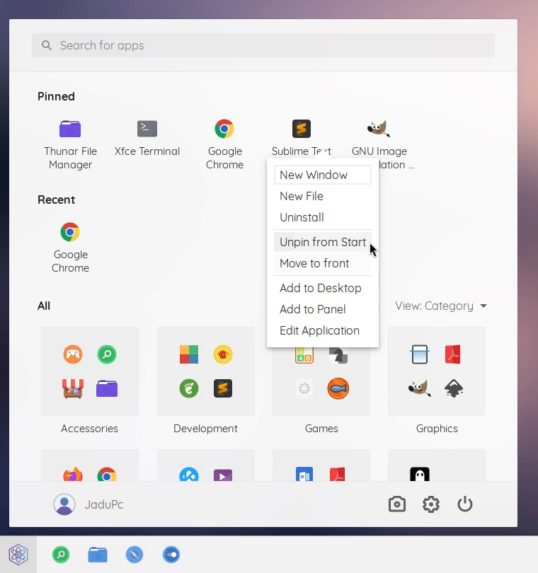
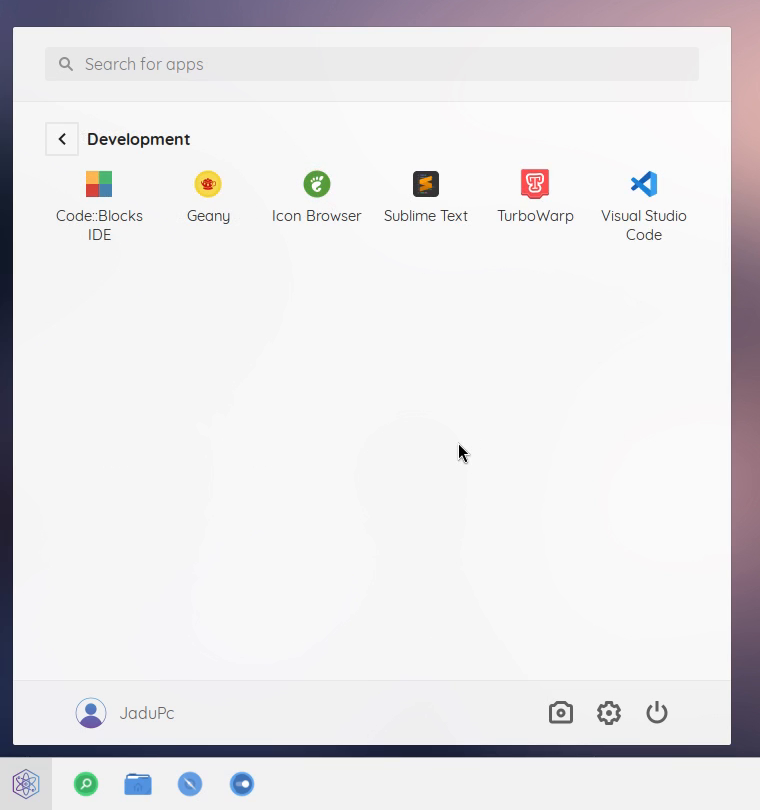
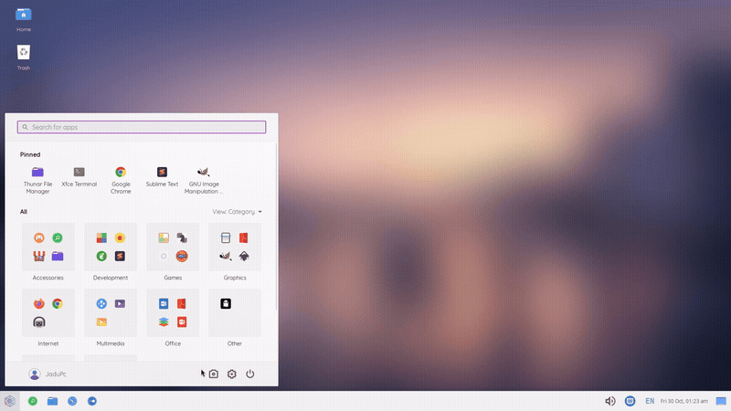
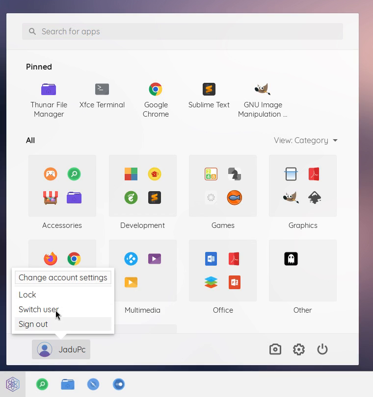
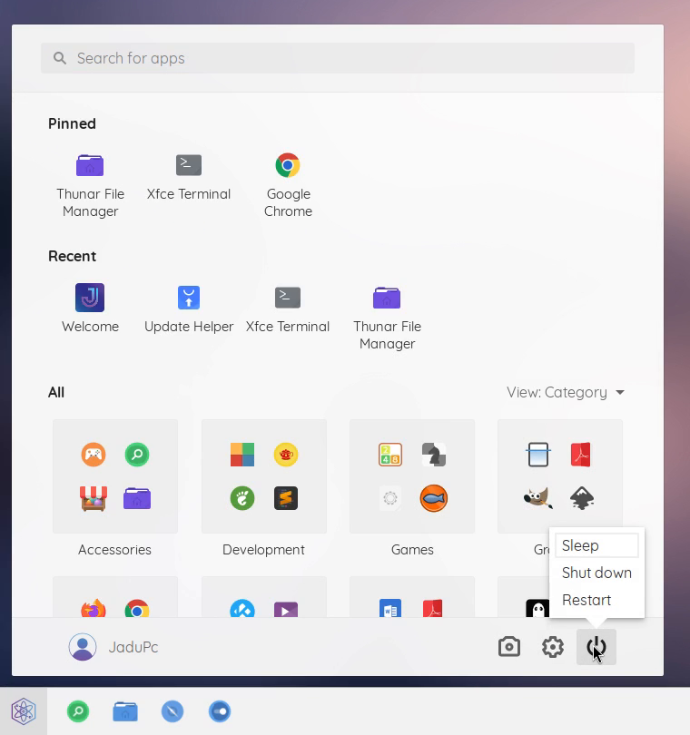
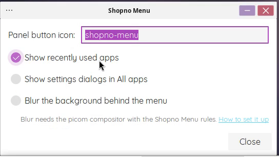

<p align="center">
  
</p>

<h1 align="center">Shopno Menu</h1>

<p align="center">
  A Windows 11 style Start menu for the Xfce panel.<br>
  No ads, no "Recommended" section. Native C, light on memory.
</p>

<p align="center">
  <a href="https://github.com/fa-saikat/xfce4-shopno-menu-plugin/releases/latest"></a>
  <a href="https://github.com/fa-saikat/xfce4-shopno-menu-plugin/actions/workflows/build.yml"></a>
  
  <a href="COPYING"></a>
</p>

<p align="center">
  <a href="#features">Features</a> ·
  <a href="#limitations">Limitations</a> ·
  <a href="#installing">Install</a> ·
  <a href="#building">Build</a> ·
  <a href="#about-the-code">About the code</a> ·
  <a href="#credits">Credits</a>
</p>

<p align="center">
  
</p>

> [!NOTE]
> Shopno Menu is young. It works, but expect rough edges, and please
> [report them](https://github.com/fa-saikat/xfce4-shopno-menu-plugin/issues/new/choose).

## Why this exists

I built Shopno Menu for [ShopnoOS](https://github.com/fa-saikat/shopno-os), our
Debian-based distro, and decided to share it. Most of our users come from
Windows, and they find their way around faster with a menu that looks and
works like the one they know. Whisker Menu is excellent and far more
configurable, but it is a classic Linux menu. I wanted a Windows 11 style one
for Xfce, so I made it.

It works on any distribution with Xfce 4.18 or newer.

## Features

<table>
  <tr>
    <td width="50%" valign="top">
      
      <p><b>All apps, three ways.</b> Category cards with icon previews, or a grid or list grouped by first letter, like Windows 11.</p>
    </td>
    <td width="50%" valign="top">
      
      <p><b>Search as you type</b>, by name, keywords or description. Enter opens the best match.</p>
    </td>
  </tr>
  <tr>
    <td valign="top">
      
      <p><b>Right-click menu</b> with the app's own actions (New Window, New Private Window…), pin and unpin, Add to Desktop, Add to Panel and Edit Application.</p>
    </td>
    <td valign="top">
      
      <p><b>Categories open as a page</b>, with a back button. Escape goes back too.</p>
    </td>
  </tr>
  <tr>
    <td colspan="2" valign="top">
      
      <p><b>Screenshot button.</b> Capture the entire screen or a region straight to the clipboard. Nothing is saved, and a notification confirms the copy.</p>
    </td>
  </tr>
  <tr>
    <td valign="top">
      
      <p><b>User menu</b> with account settings, lock, switch user and sign out.</p>
    </td>
    <td valign="top">
      
      <p><b>Power menu</b> with sleep, shut down and restart, in Windows 11 order.</p>
    </td>
  </tr>
</table>

Also:

- **Pinned apps.** On first run, your own file manager, web browser and
  terminal, as set in Xfce's Default Applications.
- **Recently used apps** row (can be turned off).
- **Settings dialogs stay out of All apps** but show up in search, like
  settings pages in Windows 11 (can be turned off).
- Follows your **GTK theme** (light or dark) and **icon theme**.
- Optional **background blur** with [picom](https://github.com/yshui/picom).
- Opens with the **Super key**, and works fully from the keyboard: type to
  search, arrow keys to move, Escape to go back.

<p align="center">
  
</p>

Session actions use the standard Xfce tools (`xflock4`,
`xfce4-session-logout`, `xfce4-settings-manager`). An action whose tool is not
installed is hidden. Switch user needs `dm-tool` (LightDM), account settings
need `users-admin` (from `gnome-system-tools`), or `mugshot` if that isn't
available, and the screenshot button needs `xfce4-screenshooter`.

## Limitations

Compared with [Whisker Menu](https://github.com/gottcode/xfce4-whiskermenu-plugin),
Shopno Menu does much less today:

- **Few settings.** Properties has the panel icon, the Recent row, settings
  dialogs and blur. There are no options for the menu's size, layout, columns,
  icon sizes or position. You can restyle it with CSS (see
  [Theming](#theming)), but that is for people comfortable editing `gtk.css`.
- **Fixed size.** The menu is 720 × 720 pixels and can't be resized.
- **No command-line options.** `xfce4-popup-shopno-menu` toggles the menu at
  the panel button. There is no option to open it at the pointer or the centre
  of the screen.
- **X11 only.** It has not been tested on Wayland.
- **Borrowed icon.** It uses the ShopnoOS logo until it has one of its own.

I'm maintaining Shopno Menu, and these are planned. If one matters to you,
[open a feature request](https://github.com/fa-saikat/xfce4-shopno-menu-plugin/issues/new/choose)
so I know what to do first.

## Installing

Download the package for your distribution from the
[latest release](https://github.com/fa-saikat/xfce4-shopno-menu-plugin/releases/latest),
then install it:

| Distribution             | File                         | Install with                                            |
|--------------------------|------------------------------|---------------------------------------------------------|
| Debian 13                | `*.debian13_amd64.deb`       | `sudo apt install ./xfce4-shopno-menu-plugin_*.deb`     |
| Ubuntu 24.04, Mint 22    | `*.ubuntu24.04_amd64.deb`    | `sudo apt install ./xfce4-shopno-menu-plugin_*.deb`     |
| Fedora                   | `*.fc*.x86_64.rpm`           | `sudo dnf install ./xfce4-shopno-menu-plugin-*.rpm`     |
| Arch Linux               | `*.pkg.tar.zst`              | `sudo pacman -U xfce4-shopno-menu-plugin-*.pkg.tar.zst` |

Each release also has a `SHA256SUMS` file to check the downloads with
`sha256sum -c --ignore-missing SHA256SUMS`.

Then restart the panel (`xfce4-panel -r`), right-click it, choose
**Panel > Add New Items…**, and add **Shopno Menu**.

For other distributions, build from source as described below.

## Building

Dependencies:

| Library          | Minimum version |
|------------------|-----------------|
| GTK              | 3.24            |
| libxfce4panel    | 4.18            |
| libxfce4ui       | 4.18            |
| libxfce4util     | 4.18            |
| garcon           | 4.18            |
| xfconf           | 4.18            |

You also need `meson`, `ninja`, a C compiler, and `gettext`.

**Debian / Ubuntu**

```sh
sudo apt install build-essential meson ninja-build gettext pkg-config \
  libgtk-3-dev libxfce4panel-2.0-dev libxfce4ui-2-dev libxfce4util-dev libxfconf-0-dev libgarcon-1-dev
```

**Fedora**

```sh
sudo dnf install gcc meson ninja-build gettext gtk3-devel \
  xfce4-panel-devel libxfce4ui-devel libxfce4util-devel xfconf-devel garcon-devel
```

**Arch Linux**

```sh
sudo pacman -S --needed base-devel meson gettext gtk3 xfce4-panel libxfce4ui libxfce4util xfconf garcon
```

Build and install:

```sh
meson setup build --prefix=/usr
meson compile -C build
sudo meson install -C build
```

The prefix must match the one Xfce is installed to (`/usr` on almost every
distribution), otherwise the panel will not find the plugin.

Then restart the panel with `xfce4-panel -r`, right-click the panel, choose
**Panel > Add New Items…**, and add **Shopno Menu**.

## Opening with the Super key

Open **Settings > Keyboard > Application Shortcuts**, add a shortcut with the
command `xfce4-popup-shopno-menu`, and press the Super key when asked.

## Background blur

Blur is drawn by the compositor, so it needs [picom](https://github.com/yshui/picom)
instead of the built-in Xfce compositor:

1. Turn off the Xfce compositor in **Settings > Window Manager Tweaks >
   Compositor**, and run picom with a blur method such as
   `blur-method = "dual_kawase";`.
2. Add the rules from [`extras/picom/shopno-menu.conf`](extras/picom/shopno-menu.conf)
   to your picom configuration.
3. Right-click the menu button, choose **Properties**, and turn on **Blur the
   background behind the menu**.

With blur off, the menu draws its own rounded corners and shadow and works
with any compositor, or none.

## Theming

Colors come from your GTK theme, and icons from your icon theme. To change
the layout or colors, override the `.shopno-menu-*` CSS classes in
`~/.config/gtk-3.0/gtk.css`. The default rules are in
[`src/resources/shopno-menu.css`](src/resources/shopno-menu.css).

## About the code

Shopno Menu is AI-assisted. It was written with
[Claude](https://claude.ai) and directed, reviewed and tested by me. I decided what it does and how it should look,
checked each change on a VM before merging it, and sent back what didn't
work. After the initial skeleton, every change went through its own issue and
pull request, so the history shows how it was built.

How it is checked today:

- CI builds the plugin on Debian 13, Ubuntu 24.04, Fedora and Arch, and builds
  and install-tests the packages for each of them.
- Before 0.2.0, the plugin went through AddressSanitizer, LeakSanitizer,
  UBSan, valgrind, GCC's static analyzer and cppcheck, plus a 200-cycle test
  that drove the real menu and measured its memory. That found one leak,
  which was fixed in 0.2.0. Nothing else turned up.
- There is no automated test suite yet.

If you find something wrong in the code, please say so in an issue. It gets
the same attention as any other bug.

## Contributing

Bug reports, translations, and patches are welcome. See
[CONTRIBUTING.md](CONTRIBUTING.md).

## Credits

Shopno Menu builds on:

- **Xfce**: the [panel plugin API](https://gitlab.xfce.org/xfce/xfce4-panel),
  [garcon](https://gitlab.xfce.org/xfce/garcon) for the applications menu,
  [xfconf](https://gitlab.xfce.org/xfce/xfconf) for settings, and
  [libxfce4ui](https://gitlab.xfce.org/xfce/libxfce4ui) and
  [libxfce4util](https://gitlab.xfce.org/xfce/libxfce4util), all on
  [GTK 3](https://gtk.org/).
- **[Whisker Menu](https://github.com/gottcode/xfce4-whiskermenu-plugin)** by
  Graeme Gott, the reference for what an Xfce menu plugin should do. Shopno
  Menu shares no code with it, but follows two of its conventions: a
  menu-type window, so xfwm4 gives it a proper menu shadow, and an
  `xfce4-popup-…` command for the Super key.
- The tools it hands work to: [picom](https://github.com/yshui/picom) for blur,
  [xfce4-screenshooter](https://gitlab.xfce.org/apps/xfce4-screenshooter) for
  screenshots, `users-admin` from gnome-system-tools and
  [Mugshot](https://github.com/bluesabre/mugshot) for account settings, and
  [exo](https://gitlab.xfce.org/xfce/exo) for Edit Application.
- **Windows 11**, whose Start menu it imitates in layout only.

## License

Shopno Menu is released under the
[GNU General Public License v2.0 or later](COPYING).

The icon in `data/icons/shopno-menu.svg` is the ShopnoOS logo, © 2026 JaduPc,
licensed under the GNU General Public License v3.0 or later. It stands in until
Shopno Menu has a logo of its own. ShopnoOS Linux is a trademark of JaduPc.

Windows is a trademark of Microsoft Corporation. This project is not
affiliated with or endorsed by Microsoft.
